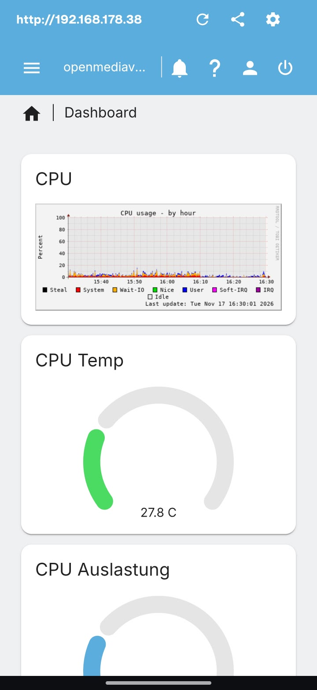
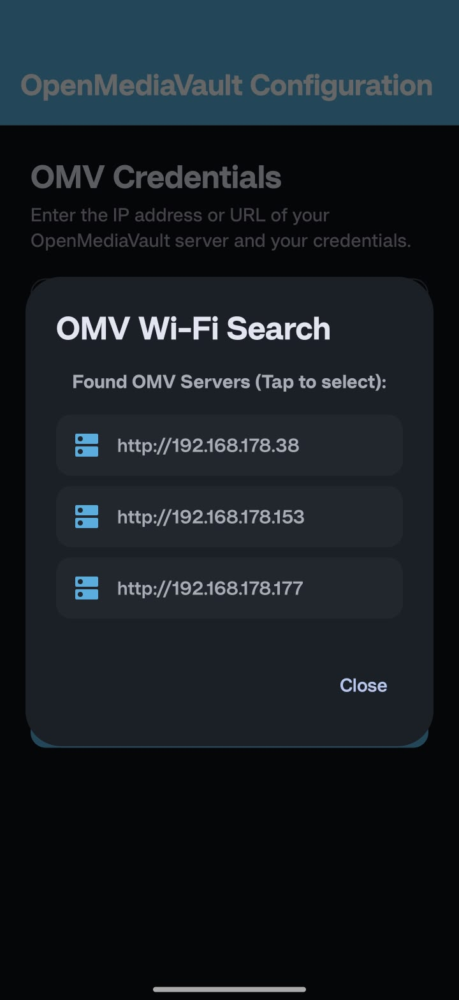
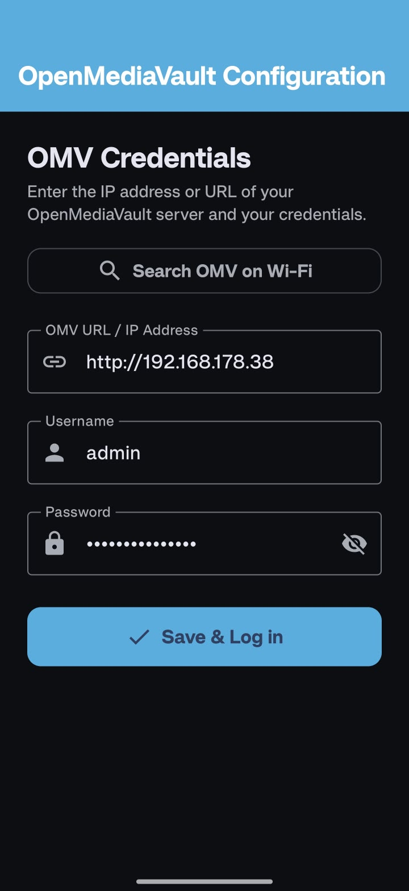

# Start OMV


## Overview

**Start OMV** is a lightweight Android companion application for [OpenMediaVault](https://github.com/openmediavault/openmediavault) (OMV 5 / 6 / 7) web interfaces.
Start OMV provides a streamlined mobile view for OpenMediaVault servers, incorporating automated credentials management, hardware-backed encryption, local Wi-Fi auto-discovery, and Android Password Manager integration.

---

<p align="center">
  
  
  
</p>

---

## Features

- **Automated Web Login**: Automatically populates login credentials when accessing OpenMediaVault Web UIs (Vue 3, Angular, ExtJS).
- **Encrypted Storage**: Stores server credentials (URL, Username, Password) using `EncryptedSharedPreferences` backed by the Android KeyStore (AES-256 GCM).
- **Network Auto-Discovery**: Built-in subnet scanner to discover OpenMediaVault instances on local Wi-Fi networks and `openmediavault.local`.
- **Password Manager Integration**: Native Autofill support (`AutofillNode` and Compose Semantics) for Google Password Manager, Bitwarden, 1Password, KeePass, etc.
- **Custom Header Bar**: Full-width header styled with `#5dacdf` brand color featuring centered server host info and quick action controls (Refresh, Open in External Browser, Settings).
- **Immersive View**: Hides system status bars to provide a clean display across notch and camera cutouts.

---

## Tech Stack

- **Language**: Kotlin
- **UI Framework**: Jetpack Compose with Material 3
- **Security**: `androidx.security:security-crypto` (`EncryptedSharedPreferences` and `MasterKey`)
- **Concurrency**: Kotlin Coroutines (`Dispatchers.IO`, `async`, `awaitAll`)
- **Web Engine**: Android `WebView` with JavaScript injection and `CookieManager`

---

## Development Note

This project was developed with the assistance of **Google Gemini Agent** (AI assistant)

---

## Getting Started

### Prerequisites

- Android Studio Ladybug (or newer)
- JDK 17 / Kotlin 2.x
- Android SDK 37 (Minimum SDK: 24 / Android 7.0+)

### Building from Source

1. Clone the repository:
   ```bash
   git clone https://github.com/HIGHVAOLATGEBEE/StartOMV.git
   cd StartOMV
   ```
2. Open the project in **Android Studio**.
3. Build the debug APK:
   ```bash
   ./gradlew assembleDebug
   ```

---

## License

This project is licensed under the MIT License - see the [LICENSE](LICENSE) file for details.

Developed by **HIGHVAOLATGEBEE**
